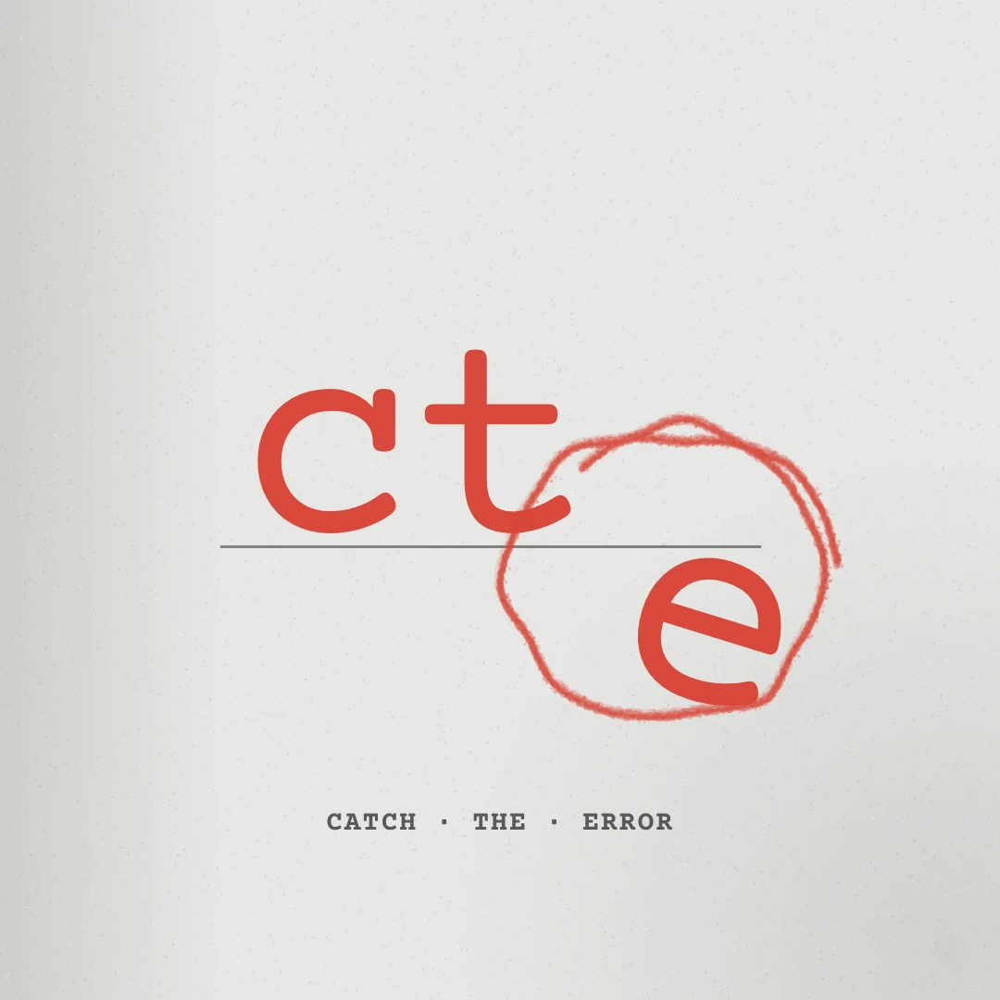

# CatchTheError brand

## Logo v3 — "ct(e)" (current, from the creator, 2026-10-27)

The letters **c t** sit on a grey rule; the **e** has dropped *below* the line and is circled in red pen: the error,
caught. Tagline `CATCH · THE · ERROR` in bold typewriter caps. Ground is light paper grey.

| File | What |
|---|---|
| `logo-v3/cte-logo-source.png` | The creator's original (1080×1080). Never edit it. |
| `logo-v3/mark-on-paper.png` | Rebuilt from the layers on flat paper (static use: avatar, thumbnails). |
| `logo-v3/layers/*.png` | `c` `t` `e` `circle` `rule` `tagline`: full-canvas 1080×1080 RGBA layers that stack back into the logo, plus `circle-crop.png` (the pen ring alone). |
| `logo-v3/geometry.json` | Each layer's box and the circle's centre (for motion). |
| `logo-v3/paper-1080x1920.png` | The logo's paper ground for 9:16 video (vignette + fixed-seed grain). |
| `build_logo_v3.py` | Rebuilds all of the above from the source PNG: `python3 brand/build_logo_v3.py`. |
| `motion/logo-sting.html` | **Reusable end-card sting** (HyperFrames scene): a red dot falls onto the line, c and t drop and bounce, the dot falls through and becomes the e, the pen circles it, the tagline types on. Usage in the file header. |
| `MOTION.md` | Transitions and moves learned from reference films (OpenAI's Terra film first). |

**Colours:** paper `#E7E7E5` · ink `#161616` · pen red `#DD483F` · rule grey `#80807E` · tagline grey `#585856`.
**Type that matches:** Courier Prime Bold (OFL) for headlines and credits; it is the logo's tagline face.

### Using the logo in a video
1. `cp brand/logo-v3/layers/*.png brand/logo-v3/paper-1080x1920.png videos/<case>/assets/logo/`
2. `cp brand/motion/logo-sting.html videos/<case>/compositions/` and mount it over the end card (see its header).
3. The pen ring (`circle-crop.png`) is the brand's way to circle the fact that matters anywhere in a video — stretch it
   round the target and draw it on with a conic mask (`ring_img()` in `videos/case-021-gpt-6-1-terra/scripts/build_scenes.py`).

## Retired
- Logo 2.0 (lens + bug mark, `logo/`, `build_logo.py`): used through Case 020. Kept for history; don't use in new videos.
